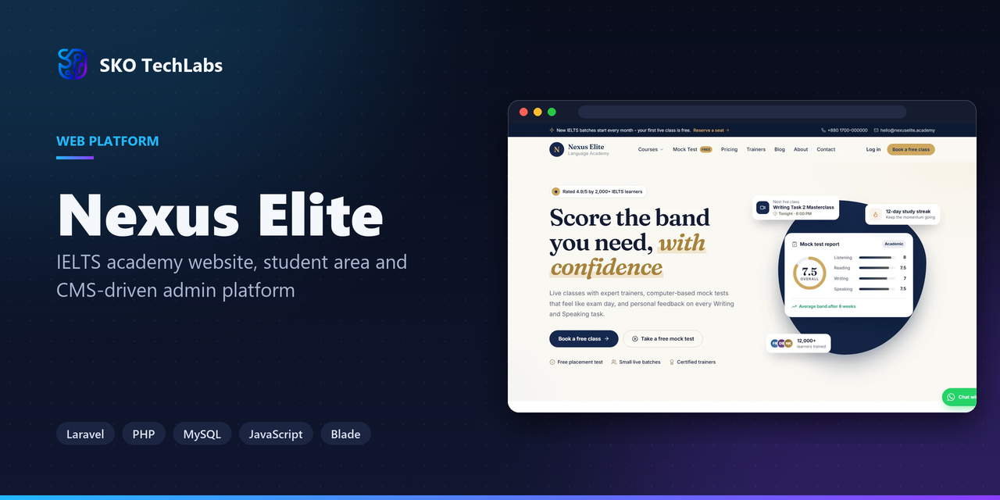
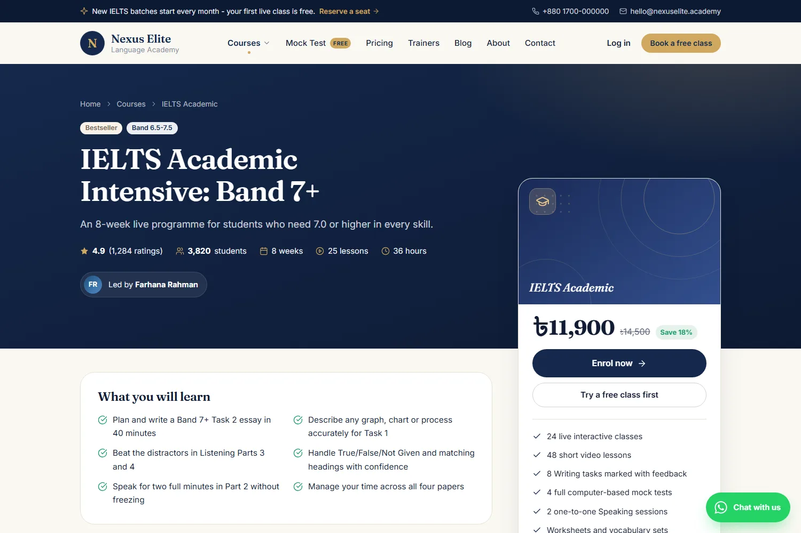
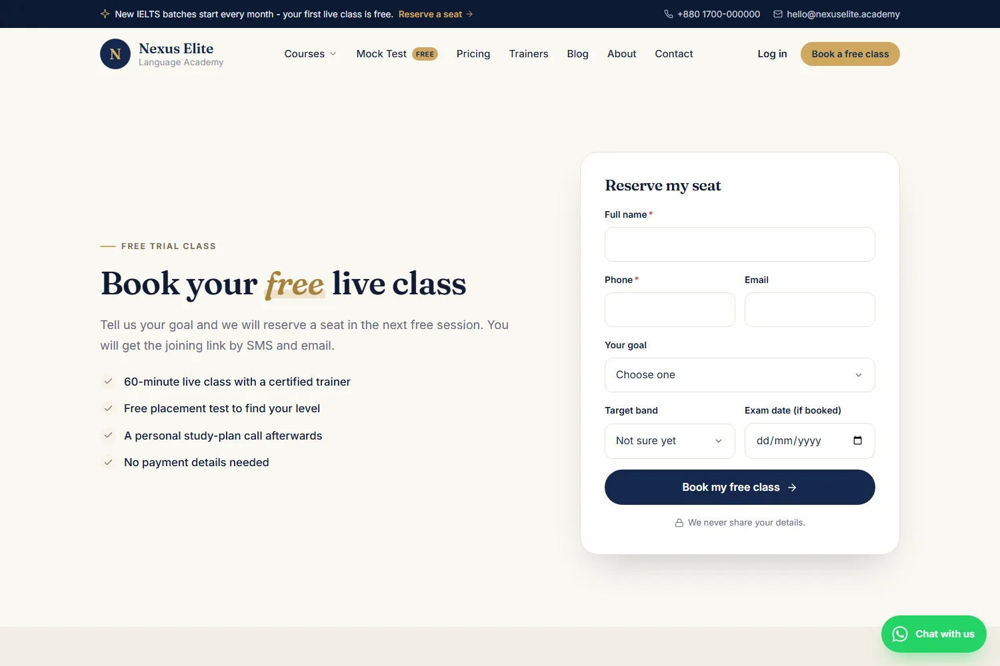
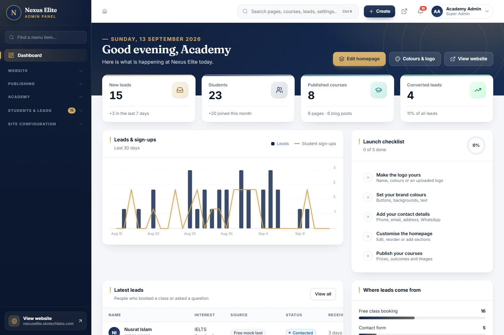
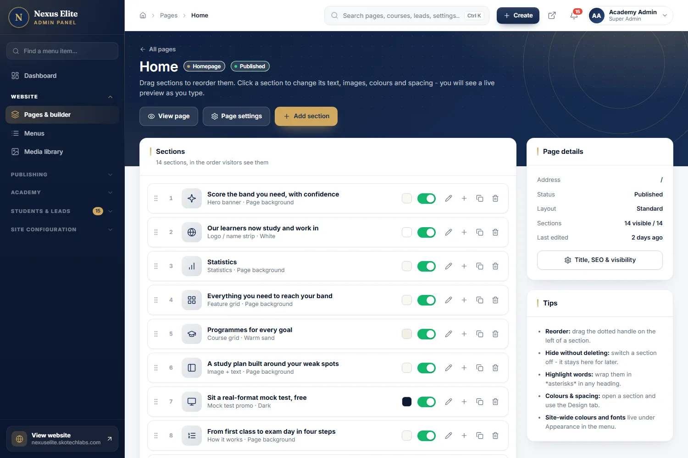
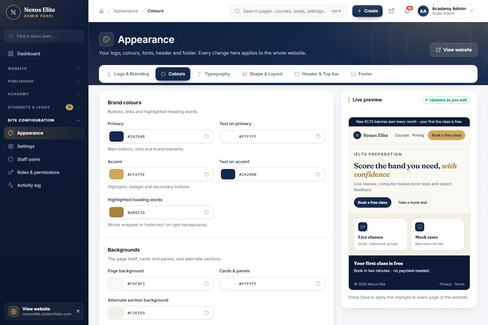
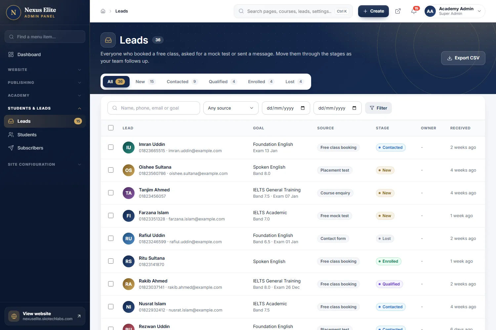

<h3>IELTS academy website, student area and CMS-driven admin platform</h3>

Website and back office for an IELTS and English academy — pages, colours and courses are managed from the admin panel, and every booking lands in one lead pipeline.

   

<a href="https://nexuselite.skotechlabs.com"><b>Live Demo</b></a> &nbsp;·&nbsp; <a href="https://skotechlabs.com/projects/nexus-elite-ielts-academy-platform"><b>Case Study</b></a> &nbsp;·&nbsp; <a href="https://skotechlabs.com/contact"><b>Request a Demo</b></a> &nbsp;·&nbsp; <a href="https://github.com/skotechlabs"><b>All Products</b></a>

---

## Overview

Nexus Elite is a website and management platform for a language academy that teaches IELTS, spoken English and foundation courses. Visitors browse courses and trainers, book a free class or a mock test, and create a student account.

Behind it sits an admin panel that runs the whole site without touching code. Pages are assembled from ready-made sections with a live preview; the logo, colours, fonts, header, footer and menus are settings; and every form on the site feeds a lead pipeline the counselling team works through, with staff roles deciding who can open which part of the panel.

<table>
<tr>
<td width="50%" valign="top">

### The Challenge

An academy's website changes every week — a new batch opens, an offer ends, a trainer joins, a course price moves. When each change needs a developer the site falls behind, and enquiries that arrive through forms, calls and chats end up on nobody's list.

</td>
<td width="50%" valign="top">

### Our Solution

Everything a visitor sees is data the academy controls. Pages are built from sections in the admin panel, the brand is a set of settings rather than a stylesheet, and courses, trainers and plans are records. Every booking and enquiry lands in a single lead pipeline, and each staff member gets a role that opens only the parts of the panel they need.

</td>
</tr>
</table>

## Key Features

- Page builder with 22 section types and a live computer, tablet and phone preview
- Logo, colours, fonts, header, footer and menus managed from the admin panel
- Course catalogue with categories, pricing, discounts and trainer profiles
- Free class, mock test and contact forms feeding one lead pipeline
- Lead stages, owner assignment, follow-up notes and CSV export
- Student accounts with login by email or phone number
- Staff roles with per-section permissions and an activity log
- Blog, testimonials, FAQs, pricing plans and partner logos
- Media library that shrinks large photos to WebP automatically
- Per-page SEO fields, sitemap.xml and structured data

## Business Impact

- Pages, offers and prices updated from the admin panel, without a developer
- Every free class and mock test booking tracked from first contact to enrolment
- Brand colours, logo and fonts changed across the whole site in one place
- Counsellors, trainers and content editors limited to their own sections
- Separate staff sign-in, so the public site looks the same to every visitor

## Screenshots

<table>
<tr>
<td width="50%" valign="top"> Course page with outcomes, pricing and enrolment</td>
<td width="50%" valign="top"> Free class booking — every submission becomes a lead</td>
</tr>
<tr>
<td width="50%" valign="top"> Admin dashboard with leads, students and a launch checklist</td>
<td width="50%" valign="top"> Page builder: reorder, hide and edit sections</td>
</tr>
<tr>
<td width="50%" valign="top"> Appearance settings with a live preview</td>
<td width="50%" valign="top"> Lead pipeline with stages, filters and CSV export</td>
</tr>
</table>

> See it running: **[nexuselite.skotechlabs.com](https://nexuselite.skotechlabs.com)**

## Technology Stack

## Source Code & Licensing

This repository is the public showcase for **Nexus Elite**. The production source code is proprietary and is maintained privately by SKO TechLabs.

Interested in this product for your business? We offer:

- **Ready-to-launch deployment** of Nexus Elite under your own brand and domain
- **Customisation** of features, workflows, languages and integrations to fit how you work
- **Custom development** of a new product built on the same foundations
- **Ongoing support**, hosting, maintenance and feature roll-outs after launch

## Get in Touch

---

© 2026 <a href="https://skotechlabs.com">SKO TechLabs</a> · Dhaka, Bangladesh · Building intelligent digital solutions

